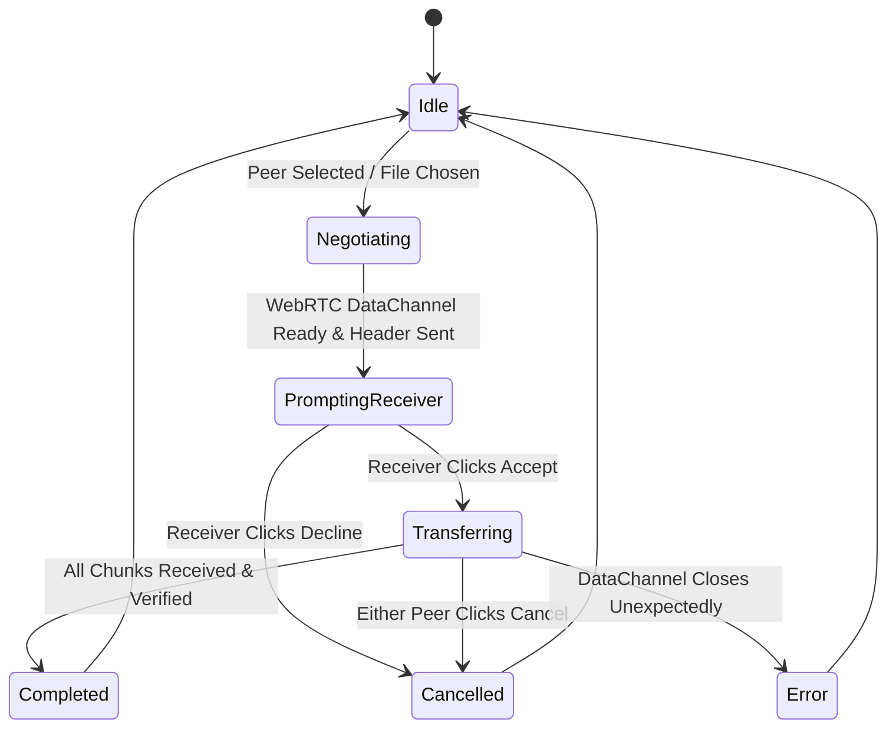

# Campus Drop — Functional Specifications

## 1. User Interaction Specifications

### 1.1 Discovery & Main Stage
- **Radar Canvas**: Concentric SVG/Canvas circular rings centered around the user's device node. Rings expand outwards with fluid CSS keyframe animations.
- **Peer Nodes**: Positioned around the radar circle. Each node displays:
  - Device type icon (`smartphone`, `monitor`, `tablet`, `laptop`).
  - Friendly display name.
  - Pairing badge (`★` or `paired` indicator) if permanently paired.
  - Room badge if connected via public room.
- **Node Interaction**:
  - **Left Click / Tap**: Opens system file chooser to send file(s) to selected peer.
  - **Right Click / Long Press**: Opens action menu (Send Message, Pair Device, View Details).
  - **Drag and Drop**: Dropping files onto a peer node immediately prompts file transfer initiation.

---

## 2. File Transfer State Machine

### 2.1 Sender Lifecycle
1. User drops or selects files for `peerId`.
2. `TransferManager` retrieves or initiates `RTCPeerConnection` with `peerId`.
3. Opens `RTCDataChannel("campusdrop-transfer", { ordered: true })`.
4. Sends JSON `TransferHeader` packet.
5. Listens for `HeaderAck`. If `accepted === false`, emits `cancelled` and terminates.
6. If `accepted === true`, reads file as 64KB `ArrayBuffer` slices.
7. Iterates through slices, checking `channel.bufferedAmount`. If > 512KB, pauses until `bufferedamountlow` event.
8. Sends JSON `TransferComplete` packet. Emits `completed` sound and UI update.

### 2.2 Receiver Lifecycle
1. `RTCDataChannel` receives message. If string, parses JSON `TransferHeader`.
2. Emits `onIncomingPrompt` with file metadata (`name`, `size`, `mimeType`).
3. Renders `ReceiveFileDialog` displaying filename, formatted size, and file type icon.
4. User clicks **Accept**:
   - Sends `HeaderAck { accepted: true }`.
   - Initializes chunk buffer / OPFS writable stream.
   - Updates progress percentage in real time.
5. Receives `TransferComplete`:
   - Closes write stream or packs chunks into `Blob`.
   - Generates object URL `URL.createObjectURL(blob)`.
   - Automatically invokes `<a download="...">` trigger or reveals Save button.
   - Plays completion audio alert.
