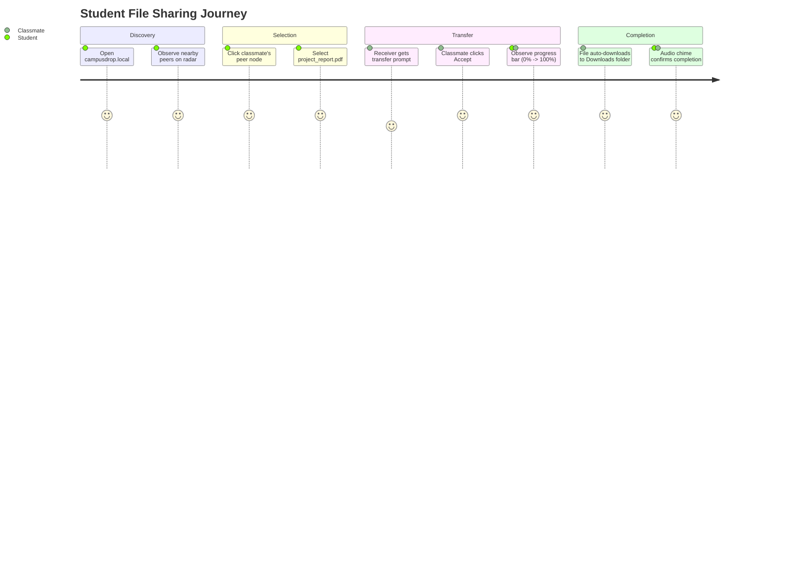

# Campus Drop — User Personas & User Flows

## 1. User Personas

### Persona A: Maya — Engineering Student
- **Profile**: 2nd-year CS student using a Linux laptop, an Android phone, and an iPad.
- **Goal**: Quickly transfer PDF lecture slides, code files, and simulation videos between devices during lab sessions.
- **Pain Point**: Bluetooth transfers are painfully slow, AirDrop doesn't work on Linux/Android, and university Wi-Fi blocks file-sharing software.
- **How Campus Drop Helps**: Maya opens `campusdrop.local` in her browser. Her devices immediately pair via QR code, allowing fast direct Wi-Fi transfers with zero installation.

### Persona B: Professor Davis — University Lecturer
- **Profile**: Academic teaching 150 students in a lecture hall.
- **Goal**: Distribute assignment templates and dataset ZIP archives directly to students' laptops in class.
- **Pain Point**: Email file size limits; cloud drive links require students to log in and drain external internet bandwidth.
- **How Campus Drop Helps**: The professor creates a public room (`CODE: CS101`) and projects the 5-character code and QR on the auditorium screen. All 150 students join and receive the files directly peer-to-peer over campus Wi-Fi.

---

## 2. Core User Flows

