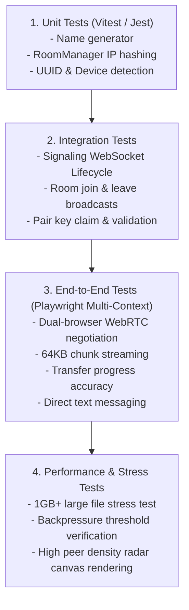

# Campus Drop — Testing Strategy & Quality Assurance

## 1. Testing Hierarchy

---

## 2. Core Test Scenarios

### Test Suite 1: Signaling Protocol
- `TEST-SIG-001`: Client connects and receives `welcome` with self metadata.
- `TEST-SIG-002`: Two clients connecting from the same IP receive `peer-joined` notifications and appear in each other's peer lists.
- `TEST-SIG-003`: Client joining a 5-character public room is isolated from LAN peers and grouped strictly with matching room peers.
- `TEST-SIG-004`: Expired pairing keys (lifetime > 5 mins) are rejected with clear error codes.

### Test Suite 2: WebRTC DataChannel & File Transfer
- `TEST-RTC-001`: Peer connection successfully reaches `connected` state across loopback/local contexts.
- `TEST-RTC-002`: File header acknowledgment: receiver acceptance initiates binary stream; receiver decline emits cancel signal to sender.
- `TEST-RTC-003`: Backpressure pacing: sender pauses transmission when `bufferedAmount` exceeds 512KB and resumes seamlessly.
- `TEST-RTC-004`: SHA-256 integrity verification: transferred file byte hash matches the source file byte hash identically.

### Test Suite 3: Mobile & Network Failure Recovery
- `TEST-NET-001`: Temporary WebSocket disruption triggers exponential reconnect without dropping established active WebRTC transfers.
- `TEST-NET-002`: Device disconnect notifies all observer peers with `peer-left`.
